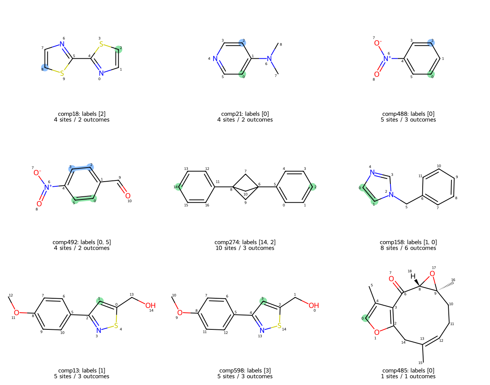

# RegJEPA

Investigating whether JEPA-derived molecular features improve regioselectivity prediction, especially with limited reaction labels and unfamiliar substrates.

The current milestone is **frozen feature extraction on validated, symmetrically distinct outcome queries**. We use a published structure-only Atom-JEPA encoder and a randomly initialized frozen copy of the same architecture. No regioselectivity prediction head has been trained yet.

See the [feature extraction report](reports/feature_extraction.md) and `data/features/latest.json` for the aligned feature bank, geometry archive, checkpoint provenance and coverage.

## Initial data decision

- 535 EAS source records, representing 534 distinct isomeric substrates.
- Every source structure parses and every source site label identifies an aromatic C-H under zero-based indexing.
- The original reagent/yield notes contain bromination, chlorination, iodination, nitration, and pooled experiments. The data must not be treated as 535 uniform-condition brominations.
- 166 records have equivalent candidate sites; 16 have equivalent observed-site counterparts omitted from their raw labels.
- A conservative, rule-filtered bromination cohort contains 299 records. It is suitable for an exploratory frozen-feature benchmark, subject to the documented limitations.

Read the [quantitative audit](reports/data_audit.md), [decision record](docs/benchmark_decisions.md), and [data dictionary](docs/data_dictionary.md). Download and open [the offline molecule browser](reports/molecule_browser.html) in a browser to inspect all structures and annotations. GitHub's file page does not execute the browser.



Green marks source-annotated sites; blue marks additional equivalent sites. Atom indices follow the original zero-based SMILES atom order. Br-marker products in the tables are hypothetical symmetry probes, not asserted observed products.

## Reproduce

Python 3.11+; the initial audit used Python 3.12.14 and RDKit 2026.09.2. Commands below assume a virtual environment is active; on Windows its interpreter can also be invoked directly as `.venv\Scripts\python.exe`.

```text
python -m venv .venv
python -m pip install -r requirements.txt
python scripts/download_data.py
python scripts/download_data.py --verify-only
python scripts/validate_benchmark.py
python scripts/build_reports.py
python -m pytest -q
```

The data downloader needs network access when raw data are absent. It verifies pinned Git blob IDs and records SHA256 checksums. Upstream data and license files are committed verbatim. Generated tables retain the original labels alongside derived symmetry information; they do not overwrite upstream annotations.

`requirements.lock.txt` additionally pins the full dependency set used for this audit; install it instead of `requirements.txt` for that exact environment. `.gitattributes` disables line-ending conversion for raw snapshots and hashed feature exports so their checksums remain valid on Windows and Linux.

## Layout

```text
data/sources.lock.json          Upstream commits, file paths, and blob hashes
data/raw/                      Immutable source snapshots and manifest
data/processed/molecules.csv   Molecule-level audit and cohort flags
data/processed/molecules.jsonl Typed molecule records
data/processed/candidate_sites.csv  Candidate atom and outcome-group table
data/processed/summary.json    Aggregate counts
data/features/                Aligned frozen feature blocks and portable 3D geometry
src/regjepa/                   Reusable ingestion, validation, and symmetry code
scripts/                       Download, audit, and report commands
tests/                         Chemistry and source-integration checks
reports/                       Audit, offline molecule browser, and examples
docs/                          Definitions, pending decisions, and experiment plan
```

## Frozen features

```text
python -m pip install -r requirements-features.txt
python scripts/setup_feature_tools.py
python scripts/extract_features.py --phase all --workers 2
python scripts/summarize_features.py
```

The setup step downloads the public molecular checkpoint at a pinned revision and, on Windows, the official checksum-verified xTB binary. Large weights, binaries and scratch calculations are cached in ignored `.cache/`. Dependencies are fully recorded in `requirements-features.lock.txt`.

The completed first bank uses one shared conformer for all 3D feature blocks. Up to 10 relaxed conformers are generated and saved per substrate, enabling a separate ensemble experiment. MMFF94 is the main relaxation method; UFF or xTB fallbacks and convergence/geometry rejections are explicitly recorded for unsupported molecules.

Each source record contributes one row per symmetrically distinct outcome. Member-atom features are averaged into one vector. Group multiplicity is not a probability weight or an additional example. The five blocks are Atom-JEPA (768 columns), random frozen backbone (768), atom-centered Morgan radii 1/2/3 (6144), xTB electronic descriptors (6), and JEPA + QM concatenation (774). Arrays are unscaled; downstream scaling belongs inside training folds.

Load an aligned cohort through `regjepa.feature_io` after installing the project (`python -m pip install -e .`), or with `src` on `PYTHONPATH`:

```python
from pathlib import Path
from regjepa.feature_io import load_feature_bank

bank = load_feature_bank(Path.cwd(), cohort="conservative_bromination")
X = bank.X["atom_jepa"]  # one row per distinct-position query
recorded_sites = bank.observed_membership
reaction_groups = bank.compound_ids
```

The loader verifies row alignment and rejects incomplete candidate sets. Use `structure_key` from `bank.queries` to keep duplicate substrates together when assigning supervised folds. See the [feature-bank dictionary](docs/feature_bank.md) for array and geometry conventions.

## Approved progression and next experiment

The cumulative cohorts are conservative bromination (299 records), conservative halogenation including Cl/I (374), broad single-outcome (495), and all source records (535). All cohorts use the same feature definitions and query identifiers. Multi-outcome and no-choice records remain flagged in the final stage.

Compare these frozen features through simple site-scoring heads on identical grouped splits. Each molecule contributes one evaluation unit. See [the first-experiment plan](docs/first_experiment.md).

## Source attribution

The vendored benchmark is from [jensengroup/db-regioselectivity](https://github.com/jensengroup/db-regioselectivity), associated with [Kromann et al., Chemical Science, 2018](https://doi.org/10.1039/C7SC04156J). Additional input structures are from [jensengroup/SI_RegioSQM20](https://github.com/jensengroup/SI_RegioSQM20), associated with [Ree et al., Journal of Cheminformatics, 2021](https://doi.org/10.1186/s13321-021-00490-7). Their MIT licenses and upstream copyright notices are preserved with the corresponding raw data. Repository code licensing has not yet been selected.

